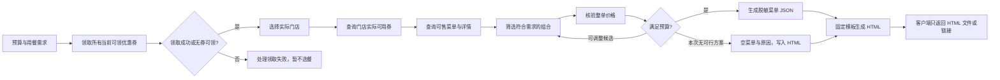

# 麦当劳 MCP 集成

## 服务与连接

- Server：麦当劳中国 MCP，`https://mcp.mcd.cn`。
- 传输：Streamable HTTP。
- 鉴权：`Authorization: Bearer <用户自己的 MCP Token>`。
- Token 申请：[官方开放平台](https://open.mcd.cn/mcp)。
- 接入及工具文档：[M-China/mcd-mcp-server](https://github.com/M-China/mcd-mcp-server)。

本项目通过运行 Skill 的客户端调用 MCP，不在 HTML 内连接 MCP。`mcp-config.example.json` 中的 `${MCD_MCP_TOKEN}` 是环境变量占位符；各客户端变量展开语法不同，应按客户端说明配置，确保请求中发送的是自己的真实 Token，而不是占位字符串。真实配置只保存在客户端本地。

## Tool 与调用流程

| Tool | 本项目的用途 |
| --- | --- |
| `auto-bind-coupons` | 每次新的真实推荐首先领取麦麦省所有当前可领优惠券 |
| `query-nearby-stores` | 到店场景选择附近门店 |
| `delivery-query-addresses` / `delivery-query-stores` | 用户选择外送时查询已有地址与可配送门店，不导出用户地址 |
| `query-meals` | 获取选定门店当前可售菜单 |
| `query-meal-detail` | 核实规格、套餐组成、替换选项 |
| `query-store-coupons` | 领取完成并选定门店后，必须查询当前门店与用餐方式可用的券 |
| `query-my-coupons` | 需要时补充查询账户已有券，不替代门店可用券查询 |
| `list-nutrition-foods` | 用户有营养需求时查询官方数据 |
| `calculate-price` | 按当前餐品、规格、数量、优惠、门店及用餐方式核验整单报价 |

实际参数从服务发现的工具 schema 获取。`auto-bind-coupons` 的范围是麦麦省当前可领券，不代表领取所有渠道、付费权益或积分兑换券；领券结果以服务返回为准。领取失败、部分失败或结果不明时先处理失败，不能跳过或盲目重复领取。明确无券可领时仍查询门店可用券，已有券可能适用。

优惠、配送费、其他费用必须纳入预算，领取券不代表能叠加使用。选餐变更后重新核价；同一轮成功领券后的改菜不重复领券，更换门店或用餐方式后重新查门店券。自动领券属于本流程的前置账号操作，流程不包含下单、积分兑换或购买付费权益。离线演示与 HTML 重播不调用领券工具。

客户端只交付 HTML 文件；页面内导出的是 PNG 海报，正常推荐包含完整菜单与预算，无匹配结果包含原因和客户端提示。PNG 在浏览器本地绘制，不调用 MCP 或外部截图服务。

真实菜单的 `sourceTools` 按本轮首次实际调用顺序记录。生成器要求 `auto-bind-coupons` → `query-store-coupons` → `query-meals`；已核价菜单还要求后续 `calculate-price`。这项校验只检查记录，真实执行及成功结果仍须核验。

没有符合预算和需求的餐品时，使用 `result.status: no-match`、`items: []`、`quote.status: not-applicable`，仍生成 HTML。客户端不在对话中列物品或解释结果，只返回 HTML。页面提示回到 `clientName` 调整需求；起价及差额只在 `calculate-price` 确实核验候选方案后显示。不要因预算为 1 元而直接判定无解，应先核查实际优惠与价格。

## 业务价值

先领取当前可领优惠券，再从实际门店可用券和可售菜单出发，在预算、人数和偏好约束下推荐餐品，通过官方报价减少价格误差。猜谜舞台让每个餐品依次登场；固定模板降低重复生成成本，结果可离线保存和分享。

## 当前核验状态

- HTML 生成器、菜单数据校验及演示交互可在本地运行。
- `data/menu.example.json` 和 `outputs/demo.html` 全部为演示数据，未调用麦当劳 MCP。
- 尚未使用参赛者的 MCP Token 完成真实门店查询与报价核验，不能把演示输出作为真实使用 MCP 的参赛证据。

真实接入后，按 `SKILL.md` 执行一次完整推荐，核对领取结果、门店可用券、餐品和报价，将脱敏后的实际 Tool 名称、查询时间与执行结果记录到本文件。不要保存 Token、券码、原始地址、手机号、完整响应或账号标识。
